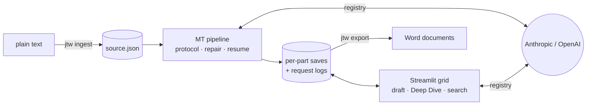

# japanese-translation-workbench

[](https://github.com/streerm/japanese-translation-workbench/actions/workflows/ci.yml)


[](LICENSE)

A workbench for translating Japanese fiction into English with large language models, built
around one idea: **a translation shouldn't be one output for one input.** Every translation,
human or machine, falls short somewhere. What if several models each produced a candidate,
and the human in the loop acted as curator and orchestrator, choosing among them and building
the best final version?

The workbench gives the translator a bird's-eye view of the translation space. Several models
translate each passage independently, and a strict segment-key protocol keeps every candidate
aligned sentence by sentence: nothing dropped, merged, invented or left in Japanese. A
Streamlit grid sets the source and every candidate side by side. There the translator writes
the final text by ear and by judgment, either drafting with a synthesis model or revising
with one in the loop, and then exports to Word.

## Background

This project began as a private workbench that I built for my own fiction translation work
and refined over several months of daily use, chapter by chapter, work by work. Each
feature exists because something went wrong in practice. Models quietly merged sentences, so the
segment-key failsafe was added. A provider substituted a different model, so the provenance
check followed. Prompts became more and more specific to individual books, so per-work
configuration replaced them. Tracking long runs called for resume, logs and per-part saves.

This repository is the **generalised, public version** of that workbench. Nothing in it is
tied to a particular book: titles, models, style rules and glossaries live in per-project
configuration, and the only bundled text is an invented test fixture.

## Features

- **Bulk MT with a failsafe.** One request per part per model. Each reply is parsed leniently
  (bold keys, code fences, chatty preambles) and accepted strictly: every key exactly once,
  in English. Rejected keys get targeted repair passes; accepted ones are saved at once.
  [How it works →](docs/mt-protocol.md)
- **Provenance.** Every response's model is checked against the one requested, so a column
  labelled *Opus 5* never silently holds another model's output. Every request is logged.
- **Resumable and frugal.** Re-running a command skips filled cells. `--parts` or `--all` is
  mandatory, and `--dry-run` prints prompts without calling anything.
- **Editing grid.** Source, every MT column, the final text and notes side by side, with
  finalise locks, merge-with-next for paragraphing, copy-to-clipboard and progress tracking.
- **Draft and Deep Dive.** 🧠 drafts a segment (or merge chain) from the MT columns; ✨ opens
  an iterative revision session driven by the translator's notes (typed or
  dictated), saved after every
  iteration and imported back with one click.
- **Word export.** Final English, a Japanese/English side-by-side draft, or the source alone,
  with header, paragraphing from merge chains, curly quotes and `**bold**`/`*italic*`.
- **Search and stats.** Bilingual search across every part with context; per-part character
  counts and progress.
- **Several works, one checkout.** Each work is a project directory with its own
  `project.toml`; private works stay untracked by git.

## Architecture



A UI-free core (`model`, `mt`, `llm`, `synth`, `export`, `text`) with two thin front ends: a
`typer` CLI and a Streamlit app. Details in [docs/architecture.md](docs/architecture.md).

## Quickstart

Requires [uv](https://docs.astral.sh/uv/); it installs Python 3.12 if needed.

```bash
git clone https://github.com/streerm/japanese-translation-workbench.git
cd japanese-translation-workbench
uv sync
cp .env.example .env               # add ANTHROPIC_API_KEY and/or OPENAI_API_KEY

uv run jtw new my-work             # creates projects/my-work/project.toml
# edit projects/my-work/project.toml: title, author, models, style notes, glossary
uv run jtw ingest my-work story.txt --split-on-headings
uv run jtw translate my-work --parts 1 --dry-run   # inspect the prompt; nothing is sent
uv run jtw translate my-work --parts 1             # translate part 1 into every column
uv run jtw serve --project my-work                 # open the workbench
```

## CLI reference

| Command | Does |
|---|---|
| `jtw new <slug>` | Create `projects/<slug>/` from the template. |
| `jtw list` | Projects with part counts and progress. |
| `jtw ingest <slug> <file.txt> [--part-chars 2500] [--split-on-headings] [--encoding utf-8] [--force]` | Split plain text into parts and segments. |
| `jtw translate <slug> (--parts 1,3-5 \| --all) [--column id]… [--repairs N] [--overwrite] [--dry-run]` | Bulk machine translation with the failsafe. Exits non-zero if anything is still blank. |
| `jtw serve [--project slug] [--port 8501] [--no-open]` | Launch the Streamlit workbench. |
| `jtw export <slug> [--what final\|side-by-side\|source] [--parts …] [-o dir]` | Word export, one file per part. |
| `jtw stats <slug> [--json]` | Character counts and progress per part. |
| `jtw search <slug> <query> [--lang ja\|en\|both] [--context 1]` | Bilingual search in the terminal. |

Parts can be named by id (`C02P01`), position (`3`) or range of positions (`3-5`).

## Adding a private work

Everything under `projects/` except `_template/` and `README.md` is ignored by git, so a work
you are translating never ends up in a commit. To keep projects outside the repository
altogether, set `JTW_PROJECTS_DIR=/path/to/projects`. Configuration is documented in
[docs/data-model.md](docs/data-model.md), and prompt customisation in
[docs/prompts.md](docs/prompts.md).

## Testing and CI

```bash
uv run ruff check . && uv run ruff format --check . && uv run mypy src && uv run pytest
```

The suite covers the core at around 99 % (line and branch, excluding the Streamlit pages,
which have their own `AppTest` smoke tests). It runs the whole pipeline end to end against
a scripted fake provider, so CI needs no API keys and never spends money. GitHub Actions runs
lint, format, type and test checks on every push. See [CONTRIBUTING.md](CONTRIBUTING.md).

## About the author

I'm Mark Streer, a Japanese→English translator and data scientist. I have translated
scientific and medical Japanese for fifteen years and, since 2022, manga and fiction for
Kodansha USA. From 2022 to 2026 I built Japanese biomedical terminology and LLM-assisted
curation workflows at SciBite (Elsevier), where I led my team's adoption of agentic AI
tooling. I hold JLPT N1 and a Graduate Certificate in Translation, and I am now reading for
the MSc in Japanese Studies at the University of Oxford.

[LinkedIn](https://www.linkedin.com/in/markstreer) · [GitHub](https://github.com/streerm)

## Licence

[MIT](LICENSE) © 2026 Mark Streer
