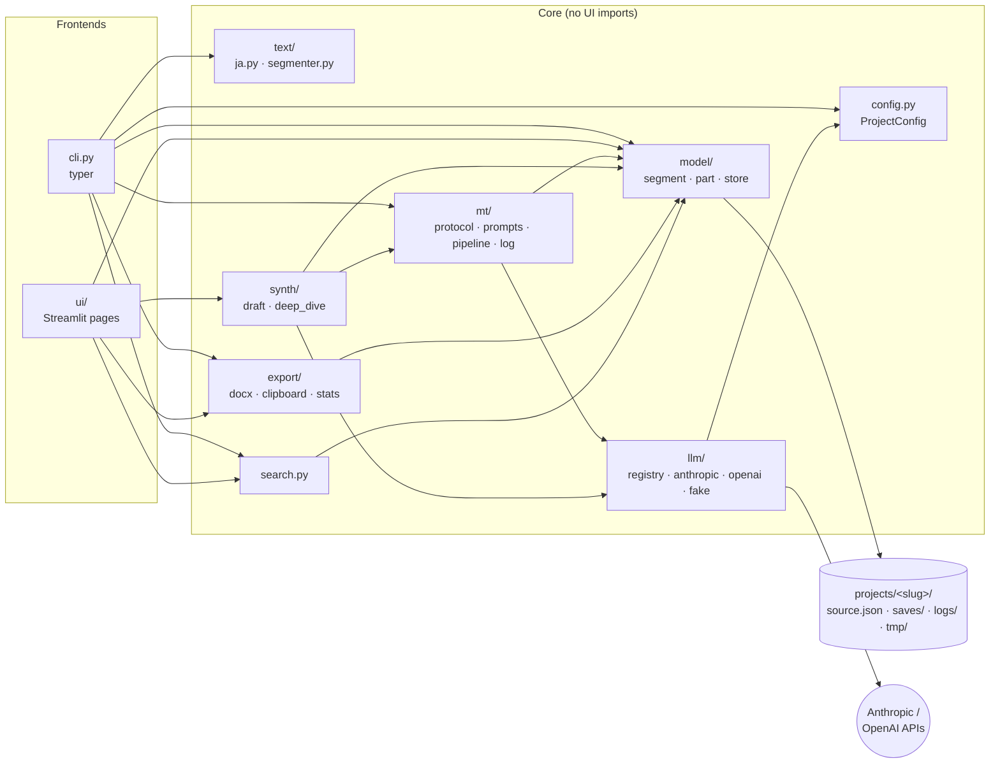

# Architecture

The workbench is a small Python package with a UI-free core and two thin front ends: a
`typer` CLI for bulk work and a Streamlit app for editing. Everything a project holds is
plain JSON/TOML on disk (see [data-model.md](data-model.md)), so the core is easy to test and
the front ends are replaceable.

## Module map



| Module | Responsibility |
|---|---|
| `config.py` | Reads `project.toml` into a validated, frozen pydantic model. |
| `paths.py` | Where a project's files live; `JTW_PROJECTS_DIR` override. |
| `text/ja.py` | **The only place** with Japanese-specific regexes and heuristics. |
| `text/segmenter.py` | Plain text → paragraphs → segments → parts. |
| `model/` | Segments, parts, chapters; loading the source, merging saves, atomic rotating saves. |
| `llm/` | `Provider` protocol, Anthropic and OpenAI adapters, a scripted `FakeProvider`, and the registry that maps columns to (provider, model) and checks every response's model. |
| `mt/protocol.py` | The segment-key contract and its lenient/strict parser ([mt-protocol.md](mt-protocol.md)). |
| `mt/prompts.py` | Template loading and slot filling ([prompts.md](prompts.md)). |
| `mt/pipeline.py` | Bulk translation: jobs, repair passes, immediate saves, resume, dry run. |
| `mt/log.py` | One JSON record per request. |
| `synth/` | Draft synthesis from the MT columns, and Deep Dive revision sessions. |
| `export/` | Word export, clipboard snippets, progress statistics. |
| `search.py` | Bilingual search with context. |
| `ui/` | Streamlit pages. Holds widget state only; every change goes through `model.store`, every model call through `llm.registry`. |

## Data flow: one bulk run

```mermaid
sequenceDiagram
    participant U as jtw translate
    participant P as mt.pipeline
    participant S as model.store
    participant R as llm.registry (Route)
    participant M as Model API
    U->>P: parts, columns
    P->>S: load source + saves
    P->>P: build jobs (skip filled cells)
    loop each (part, column)
        P->>R: complete(prompt)
        R->>M: request
        M-->>R: text + served model
        R-->>P: result (or ModelMismatch)
        P->>P: parse_response → accepted + rejected keys
        P->>S: save accepted keys (re-read first)
        P->>P: log request
        alt keys rejected and repairs left
            P->>R: repair prompt (rejected keys only)
        end
    end
    P-->>U: summary; exit 1 if anything is still blank
```

## Design principles

- **No silent failure.** Rejected segments are listed by category, logged and left blank;
  a substituted model is discarded; orphaned saved segments are kept and reported.
- **No accidental spend.** Translation needs `--parts` or `--all`; `--dry-run` calls nothing;
  tests never reach the network.
- **Configuration, not code, for anything work-specific.** Titles, names, models, labels,
  style rules and glossary live in `project.toml`; prompts are overridable templates.
- **Thin UI.** Business logic is testable without Streamlit; the UI could be replaced.

## Decisions

Recorded where the implementation departs from, or refines, the original plan.

| Decision | Why |
|---|---|
| Repository `japanese-translation-workbench`, package and command `jtw` (planned: `llm-translation-workbench` / `ltw`). | The project is Japanese → English only; the name says so. |
| OpenAI calls use the **Responses API** with `max_output_tokens`, plus `reasoning.effort` for reasoning models (the plan mentioned Chat Completions' `max_completion_tokens`). | The Responses API is OpenAI's current interface and is what the code being ported used; `temperature` is still never sent. |
| Draft and Deep Dive replies use the **same segment-key format** as MT (plus a `[COMMENTARY]` section) rather than JSON. | JSON with unescaped quotation marks in dialogue was the commonest failure in practice; one parser also means one set of guarantees. |
| A key absent *between* two returned keys is classed as `merged`; absent before the first or after the last as `missing`. | Distinguishes a model folding sentences together from a truncated or skipped reply, which need different fixes. |
| Default prompts and the project template live at the repository root and are bundled into the wheel with `force-include`. | One copy of each file, found both in a source checkout and in an installed package. |
| Streamlit pages are small files under `ui/pages/` that call `render()` in `ui/<page>.py`. | `AppTest` can only switch to file-based pages; the logic stays in importable modules. |
| `jtw ingest` reads a file with no blank lines as one paragraph per line. | Much Japanese plain text puts each paragraph on one line with no blank lines between. |
